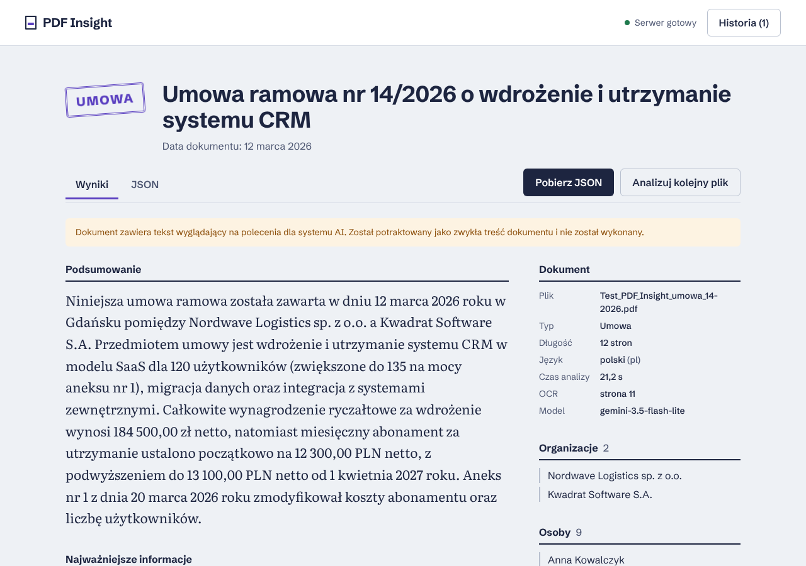

# PDF Insight

Aplikacja webowa, która wczytuje plik PDF, tworzy jego krótkie podsumowanie i zamienia treść
w uporządkowane dane JSON zgodne ze schematem z briefu.

- **Demo:** https://kstatharas.github.io/pdf-insight/
- **API:** https://pdf-insight-api-fplc.onrender.com (`/api/health`, dokumentacja OpenAPI pod `/docs`)

Nie masz PDF pod ręką? Na stronie startowej jest przycisk **„Przeanalizuj przykładową umowę”**
(`samples/Test_PDF_Insight_umowa_14-2026.pdf`: 12 stron, skan aneksu, pułapka prompt injection).



## Jak to działa

```
Przeglądarka (React SPA, GitHub Pages)
   │  POST /api/analyze  (multipart, plik PDF ≤ 10 MB)
   ▼
Backend (FastAPI w Dockerze, Render)          klucz API tylko tutaj (zmienna środowiskowa)
   1. walidacja pliku (rozmiar, sygnatura %PDF-, liczba stron)
   2. ekstrakcja tekstu warstwy tekstowej (pypdfium2)
   3. strony bez warstwy tekstowej (skany) renderowane do JPEG i dołączane jako obraz
      do tego samego zapytania analizy (OCR w jednym wywołaniu modelu)
   4. podział długich dokumentów na fragmenty, analiza fragmentów równolegle, scalenie wyników
   5. odpowiedź modelu walidowana schematem (Pydantic); przy błędzie 1 ponowna próba
   ▼
Google Gemini — natywne API generateContent, odpowiedź wymuszona JSON Schema;
przy przeciążeniu (503/429) automatyczne przejście na kolejny model z listy
```

Frontend ponownie waliduje odpowiedź schematem Zod (`frontend/src/lib/schema.ts`) zanim ją
wyświetli, zapisze w historii lub pozwoli pobrać.

### Zakres (brief, sekcja 02)

| Punkt | Status | Gdzie |
| --- | --- | --- |
| F-01 Wgrywanie PDF (drag & drop, wybór pliku, tylko PDF, maks. 10 MB) | ✅ | `UploadPanel.tsx`, `lib/validateFile.ts`, limit także w backendzie |
| F-02 Odczyt tekstu | ✅ | `backend/app/pdf_extract.py` |
| F-03 Podsumowanie 3–5 zdań w języku dokumentu | ✅ | `backend/app/prompts.py` |
| F-04 Dane strukturalne walidowane przed wyświetleniem | ✅ | Pydantic (`schemas.py`) + Zod (`lib/schema.ts`) |
| F-05 Widok, podgląd JSON, pobranie `.json` | ✅ | `ResultView.tsx`, `JsonPreview.tsx`, `lib/download.ts` |
| F-06 Stany: ładowanie, błąd z ponowieniem, stan pusty | ✅ | `AnalysisProgress.tsx`, `ErrorPanel.tsx`, `UploadPanel.tsx` |
| F-07 Publiczne demo na GitHub Pages | ✅ | `.github/workflows/frontend.yml` |
| F-08 Długie dokumenty (fragmenty + scalanie) | ✅ | `backend/app/chunking.py`, `analyzer.py` |
| F-09 Historia analiz w przeglądarce | ✅ | `lib/history.ts` (localStorage, 10 ostatnich) |
| F-10 OCR skanów | ✅ | obraz strony w zapytaniu do multimodalnego modelu (max 4 strony) |
| Dodatkowo: język interfejsu PL/EN | ✅ | `src/i18n/`, `/api/translate` — zob. niżej |

## Decyzje

- **Ekstrakcja tekstu w backendzie, nie w przeglądarce.** Backend i tak jest potrzebny jako
  proxy do AI, a robiąc ekstrakcję po stronie serwera mamy jedno miejsce na OCR skanów
  (renderowanie strony do obrazu), kontrolę liczby stron i limitów. Dzięki temu frontend nie
  potrzebuje pdf.js ani konfiguracji jego workera.
- **Natywne API Gemini.** Darmowy limit wystarcza na demo. AI Studio wydaje od 2026 r. klucze
  „AQ.”, których endpoint zgodny z OpenAI często nie akceptuje (401), dlatego domyślnie używany
  jest natywny `generateContent` z nagłówkiem `x-goog-api-key`. Klient zgodny z OpenAI został
  jako opcja (`LLM_PROVIDER=openai`) — zmiana dostawcy to zmiana zmiennych środowiskowych.
- **Model: Gemini 3.5 Flash-Lite z listą zapasowych.** Na darmowym kluczu większe modele Flash
  odpowiadały 503 (przeciążenie), a Flash-Lite mieści się w limicie 30 s. Przy 503/429/404
  backend próbuje kolejnych modeli z `LLM_FALLBACK_MODELS` i zapamiętuje ten, który odpowiedział.
- **OCR w tym samym wywołaniu.** Osobne wywołanie OCR dla zeskanowanej strony zajmowało ok. 19 s
  z 34 s całej analizy. Obraz strony trafia teraz do zapytania analizy z tym samym znacznikiem
  `[page N]`, więc model czyta tekst i skan naraz. Bez Tesseracta obraz Dockera jest lżejszy,
  a polskie znaki i pieczątki są odczytywane lepiej. Limit: 4 zeskanowane strony.
- **Pomiar czasu.** `meta.stepsMs` podaje czas każdego kroku (ekstrakcja, analiza, scalanie).
- **Dwie walidacje schematu.** Backend odrzuca błędną odpowiedź modelu (i prosi o poprawkę
  raz), frontend nie ufa sieci i sprawdza wynik jeszcze raz.
- **Bez routera.** Aplikacja ma jeden widok ze stanami, więc problem z odświeżaniem podstron na
  GitHub Pages w ogóle nie występuje; `base` w Vite ustawia workflow (`/<repo>/`).
- **XMLHttpRequest zamiast fetch** przy wysyłce, bo tylko XHR raportuje postęp uploadu.
- **Pole `meta`** (model, czas, strony OCR, ostrzeżenia) dodane do schematu — brief pozwala
  dodawać pola.

## Język interfejsu (polski / angielski)

W nagłówku jest lista **Język / Language**. Wybór zmienia cały interfejs (teksty, komunikaty
błędów, ostrzeżenia, format liczb i dat) i jest zapamiętywany w przeglądarce; domyślnie polski.

- **Tytuł, podsumowanie, kluczowe informacje oraz opisy kwot i terminów** są tłumaczone na
  wybrany język jednym zapytaniem (`POST /api/translate` z listą tekstów). Tłumaczenie jest zapisywane
  w przeglądarce, więc ponowne przełączenie nie wysyła kolejnego zapytania.
- **Wynik analizy i plik JSON nie zmieniają się** — zawsze są w języku dokumentu. Tłumaczenie
  dotyczy tylko widoku. Nazwy stron, osoby i słowa kluczowe zostają w oryginale.
- W trakcie tłumaczenia teksty mienią się „atramentem”, a obok zakładek widać znacznik
  „Tłumaczę…”; po zakończeniu przetłumaczone teksty pojawiają się z krótką animacją.
- Ostrzeżenia mają kody (`meta.notices`), dzięki czemu interfejs pokazuje je w swoim języku;
  pole `meta.warnings` (po polsku) zostało bez zmian.
- `/api/translate` traktuje teksty jako dane (polecenia w nich są tłumaczone, nie wykonywane),
  wymaga dokładnie jednego tłumaczenia na tekst (inaczej 1 ponowna próba), przyjmuje do 120
  tekstów (łącznie 30 000 znaków) i ma osobny limit (40 zapytań / 10 min na IP).

## Animacje

Ruch opowiada tę samą historię co wygląd (papier i pieczątka): arkusz unosi się nad strefą
upuszczania, podczas analizy przesuwa się po nim wiązka skanera, wynik „przybija” pieczątka,
a potem kolejno pojawiają się sekcje, kwoty „odliczają się” do wartości, a oś czasu rysuje się
w dół. Wszystkie animacje są wyłączone, gdy system prosi o ograniczenie ruchu
(`prefers-reduced-motion`).

## Bezpieczeństwo

- Klucz API istnieje tylko w zmiennych środowiskowych backendu (Render). W repozytorium jest
  wyłącznie `.env.example`; `.env` jest w `.gitignore`.
- **Prompt injection:** treść PDF trafia do modelu wewnątrz znaczników `<document>` jako dane,
  prompt systemowy zabrania wykonywania poleceń z dokumentu, a znaczniki w treści są usuwane.
  Dodatkowo heurystyka wykrywa typowe frazy („zignoruj wcześniejsze polecenia”) i pokazuje
  użytkownikowi ostrzeżenie. Przykładowa umowa zawiera taką pułapkę w § 5 — model jej nie
  wykonuje.
- CORS ograniczony do `https://kstatharas.github.io` (`ALLOWED_ORIGINS`).
- Limit rozmiaru (10 MB, sprawdzany już po nagłówku `Content-Length`), liczby stron, liczby
  równoległych analiz (3) i żądań na IP (10 na 10 minut).
- Frontend: brak `dangerouslySetInnerHTML` (wymuszone regułą ESLint), Content-Security-Policy
  pozwalająca łączyć się tylko z adresem API, `referrer: no-referrer`.
- Użytkownik widzi informację, że plik trafia do usługi AI (Google Gemini).

## Uruchomienie lokalne

Wymagania: Python 3.12+, Node.js 22.12+.

```bash
# Backend
cd backend
python -m venv .venv && source .venv/bin/activate   # Windows: .venv\Scripts\activate
pip install -r requirements-dev.txt
cp .env.example .env        # wpisz LLM_API_KEY (https://aistudio.google.com/apikey)
uvicorn app.main:app --reload --port 8000

# Frontend (w drugim terminalu)
cd frontend
npm install
cp .env.example .env.local  # VITE_API_URL=http://localhost:8000
npm run dev                 # http://localhost:5173
```

Testy i jakość kodu:

```bash
cd backend  && ruff check . && ruff format --check . && mypy app && pytest
cd frontend && npm run format:check && npm run lint && npm run typecheck && npm test
```

### Zmienne środowiskowe

| Zmienna | Gdzie | Opis |
| --- | --- | --- |
| `LLM_API_KEY` | backend | klucz Google AI Studio (wymagany) |
| `ALLOWED_ORIGINS` | backend | dozwolone originy CORS, np. `https://kstatharas.github.io` |
| `LLM_PROVIDER`, `LLM_MODEL`, `LLM_FALLBACK_MODELS` | backend | dostawca (`gemini`/`openai`), model i modele zapasowe |
| `MAX_FILE_MB`, `RATE_LIMIT_*`, `TRANSLATE_RATE_LIMIT_REQUESTS`, `CHUNK_CHARS`, `OCR_*` | backend | limity, zob. `backend/.env.example` |
| `VITE_API_URL` | frontend | adres backendu; w GitHub Actions jako *repository variable* |
| `VITE_BASE_PATH` | frontend | ścieżka bazowa; workflow ustawia `/<repo>/` |

## Wdrożenie

1. **Backend (Render):** *New → Blueprint* → to repozytorium. Render czyta `render.yaml`,
   buduje obraz z `backend/Dockerfile` i prosi o `LLM_API_KEY`.
2. **Frontend (GitHub Pages):** *Settings → Pages → Source: GitHub Actions*; w *Settings →
   Secrets and variables → Actions → Variables* dodaj `VITE_API_URL` z adresem backendu.
   Workflow `Frontend` wykonuje lint › testy › build › deploy przy każdym pushu do `main`.
3. Workflow `Keep backend warm` co 10 minut odpytuje `/api/health`, żeby darmowa instancja
   Render nie usypiała (zimny start trwa do minuty).

## Znane ograniczenia

- Darmowe limity Gemini są niewielkie, a modele bywają przeciążone (503). Backend przechodzi
  wtedy na kolejne modele; jeśli wszystkie są niedostępne, użytkownik dostaje komunikat
  z przyciskiem „Spróbuj ponownie”.
- Heurystyka wykrywania prompt injection sprawdza tylko warstwę tekstową — polecenia ukryte na
  skanie są ignorowane przez prompt, ale nie dają ostrzeżenia w interfejsie.
- Jeśli instancja Render mimo wszystko uśnie, pierwsza analiza może trwać dłużej niż 30 s.
  Aplikacja pinguje backend przy otwarciu strony i pokazuje jego stan w nagłówku.
- Limit żądań jest w pamięci procesu (jedna instancja) i opiera się na adresie z nagłówka
  `X-Forwarded-For` ustawianego przez proxy hostingu.
- OCR obejmuje maksymalnie 4 zeskanowane strony; pozostałe są pomijane z ostrzeżeniem.
- Bardzo długie dokumenty (powyżej ok. 240 tys. znaków) są analizowane częściowo — wynik zawiera
  ostrzeżenie z procentem przeanalizowanej treści.
- Model może pominąć część kwot lub dat w bardzo gęstych dokumentach (limit 25 kwot i 20 dat na
  fragment). Wynik zawsze jest zgodny ze schematem, ale nie zawsze kompletny.

## Struktura

```
backend/            FastAPI: ekstrakcja, OCR, chunking, klient LLM, walidacja (pytest, ruff, mypy)
frontend/src/
  api/              klient HTTP (upload z postępem, tłumaczenie, health check)
  i18n/             słowniki PL/EN, kontekst języka, komunikaty błędów
  components/       widoki: upload, postęp, błąd, wynik, historia, JSON
  lib/              schemat Zod, walidacja pliku, historia, formatowanie, eksport
samples/            przykładowy dokument testowy
.github/workflows/  CI backendu, CI/CD frontendu, keep-warm
render.yaml         konfiguracja hostingu backendu
AI_LOG.md           praca z narzędziami AI
```
